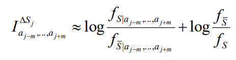
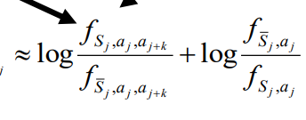
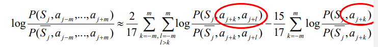

# Formula Documentation
This document describes the formulas used in the secondary structure prediction task.
## General Formulas

Quality of a prediction: 
- for a single state: $Qi = \frac{number\ of\ residues\ correctly\ predicted\ in\ state\ i}{number\ of\ residues\ observed\ in\ state\ i} * 100\%$
- for all three states: $Q_3 = \frac{number\ of\ residues\ correctly\ predicted}{number\ of\ all\ residues } * 100\%$

## GOR - Formulas
### I-Values

- $I_a^S = log(\frac{P(S|a)}{P(S)})$

- $I_a^{\Delta S_j} \approx log(\frac{f_{S,a}}{f_{\overline{S},a}}) + log(\frac{f_{\overline{S}}}{f_S})$

- GOR 1: $I^{\Delta S_j}_{a_{j-m},...,a_{j+m}}\approx \sum{}_{k = -m}^{m} {I^{\Delta S_j}_{a_{j+k}}}$ 

  For GOR 1 we need to calculate the I - Value for each combination amino acid in the window and each secondary structure. To do that we take the relative frequency $f$ (e.g. $f_{S,a}$) is relative frequency of the secondary structure appearing given the amino-acid appearing. Then we sum up all of these Values for each secondary stucture. 
  Then you have calculated the 3 Probabilities and the biggest one is the Secondary Structure you choose for the center amino - acid.

- GOR 1:

    
- GOR 3: 

    

- GOR 4:

    

 
